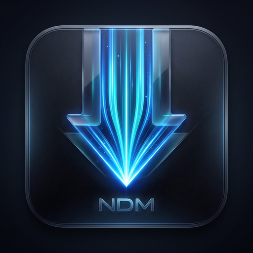
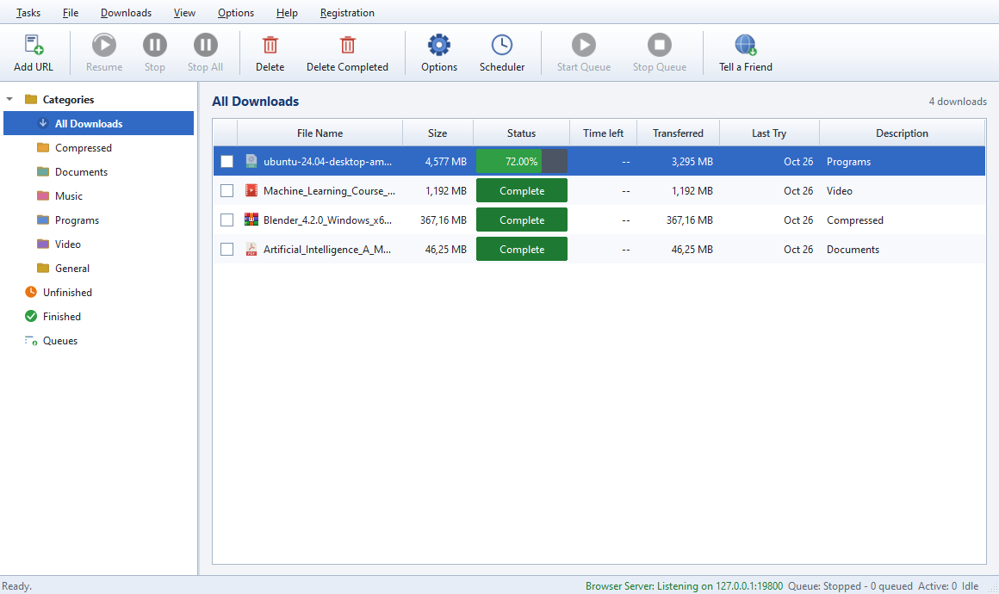
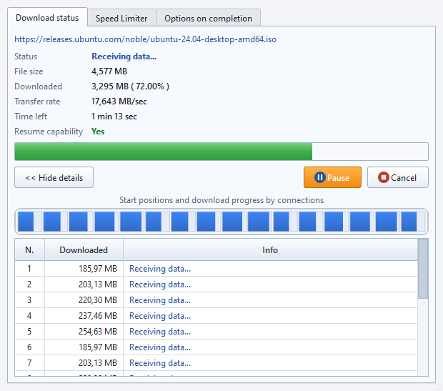
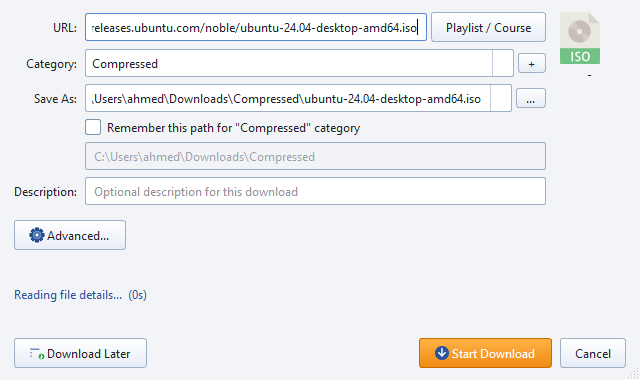
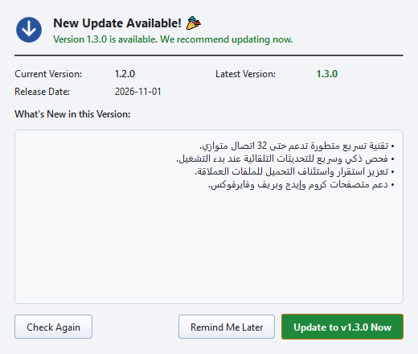
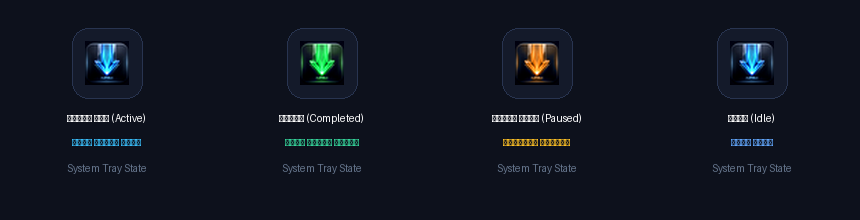

<p align="center">
  
</p>

<h1 align="center">Nasaq Download Manager (NDM)</h1>

<p align="center">
  <strong>The Next-Generation High-Speed Download Manager for Windows</strong>
</p>

<p align="center">
  <a href="https://github.com/ahmedsamir10090/ndm/releases/latest">
    
  </a>
  <a href="https://github.com/ahmedsamir10090/ndm/releases/latest">
    
  </a>
  <a href="https://github.com/ahmedsamir10090/ndm/releases/latest">
    
  </a>
  <a href="https://github.com/ahmedsamir10090/ndm/releases/latest">
    
  </a>
</p>

<p align="center">
  <a href="https://github.com/ahmedsamir10090/ndm/releases/download/v1.2.0/NDM_Setup.exe">
    
  </a>
  <a href="https://ahmedsamir10090.github.io/ndm/">
    
  </a>
</p>

---

## ⚡ What is Nasaq Download Manager (NDM)? / ما هو برنامج نسق؟

**Nasaq Download Manager (NDM)** is a powerful, lightweight, and modern download accelerator designed for Windows. Built to provide lightning-fast download speeds with dynamic multi-threaded segmentation (up to 32 parallel connections), comprehensive media sniffing (YouTube, Facebook, X, Vimeo, and more), full browser integration, and intelligent automatic in-app updates.

**نسق (NDM)** هو برنامج تحميل عصري فائق السرعة لنظام ويندوز، صُمم ليمنحك أقصى سرعة ممكنة عبر تقنية الاتصالات المتعددة الديناميكية (من 8 إلى 32 اتصال متوازي)، مع دعم متطور لتحميل الفيديوهات من كافة المنصات العالمية والمحلية (يوتيوب، فيسبوك، إكس، تيك توك، فيميو وغيرها)، وتكامل كامل مع جميع المتصفحات، ونظام تحديثات تلقائي متكامل.

---

## 📸 Screenshots / لقطات حقيقية من داخل البرنامج

### 1. الواجهة الرئيسية (Main Dashboard)


### 2. نافذة مراقبة التحميل وتقسيم الـ 32 اتصال (Turbo Parallel Monitor)


### 3. إضافة تحميل جديد واقتطاع الفيديو (Smart Add Dialog & Clip Downloader)


### 4. التحديث التلقائي المباشر (One-Click In-App Updater)


---

## 🚀 Key Features / أبرز المميزات

### 1. ⚡ Turbo Multi-Connection Engine (تسريع التحميل الخارق)
* **Up to 32 Parallel Connections**: Segments files dynamically into chunks and downloads them simultaneously, with throughput determined by your connection and the source server.
* **Live Connection Monitor**: Real-time visual chunk bar and connection table showing bytes received and speed for each individual thread, identical to IDM.
* **Auto-Resume & Recovery**: Comprehensive support for pausing and resuming interrupted downloads without starting over.

### 2. 🎬 Universal Media Sniffer & Video Grabber (التقاط الفيديوهات الشامل)
* **Direct High-Resolution Video Sniffing**: Capture direct streams (`1080p`, `2K`, `4K`, `60fps`) with original audio track synchronization.
* **Streaming Sites Support**: Full integration with **YouTube**, **Facebook**, **X (Twitter)**, **TikTok**, **Vimeo**, and popular video platforms.
* **Clip Download (تحميل جزء من الفيديو فقط)**: Crop any video by setting start and end timestamps directly before downloading.
* **Playlist & Course Downloader (تحميل القوائم والكورسات كاملة)**: One-click batch download for entire video playlists, series, or educational courses.

### 3. 🌐 Full Browser Integration (التكامل التام مع المتصفحات)
* Native integration for **Google Chrome**, **Microsoft Edge**, **Brave**, **Opera**, and Chromium-based browsers.
* Floating video download button hovering on top of web video players.
* Right-click context menu: `Download link with NDM` and `Download page video with NDM`.

### 4. 🔄 Smart In-App Updater (التحديث التلقائي واليدوي)
* **Automatic Silent Startup Check**: Checks for new updates when starting the app without interrupting your workflow.
* **Manual Update Action**: Check for updates anytime from `Help -> Check for Updates...` or the system tray menu.
* **One-Click In-App Upgrade**: View release changelog, download update packages with SHA-256 verification, and automatically restart into the latest version.

### 5. 🖥️ Universal Windows Compatibility (توافق شامل مع جميع نسخ ويندوز)
* Compatible with **Windows 10** and **Windows 11** (64-bit).
* Standalone offline installer built with Inno Setup. No external runtimes or dependencies needed.

### 6. 🎨 Dynamic System Tray States & Multi-Resolution Icon (تفاعل أيقونة النظام الذكية)
* **Smart Multi-Resolution (.ico)**:
  * **256x256 & 128x128**: Full 3D Glassmorphism, glowing neon speed rays, and squircle frame for desktop shortcuts.
  * **16x16, 24x24 & 32x32**: High-contrast, razor-sharp flat glowing arrow for the Windows system tray and browser extensions.
* **Interactive Tray States (تفاعل الأيقونة المباشر بجوار الساعة)**:
  * 🔵 **Active Download (تحميل نشط)**: أزرق سماوي نابض (Electric Cyan).
  * 🟢 **All Completed (اكتمال كافة التنزيلات)**: أخضر زمردي متوهج (Emerald Green).
  * 🟠 **Paused (متوقف مؤقتاً)**: برتقالي تحذيري (Amber / Orange).
  * ⚪ **Idle (الوضع العادي)**: أزرق هادئ.

<p align="center">
  
</p>

---

## 📥 Download & Installation / التحميل والتثبيت

### Official Download Link:
| File | Version | Size | Checksum (SHA-256) |
| :--- | :---: | :---: | :--- |
| [**NDM_Setup.exe**](https://github.com/ahmedsamir10090/ndm/releases/download/v1.2.0/NDM_Setup.exe) | `1.2.0` | `56.67 MiB` | `48d1ac337e2dbb39b4d938998d4ab9bd8f16bddcb80329a908a563c1b85e16bc` |

### Quick Installation:
1. Download **[NDM_Setup.exe](https://github.com/ahmedsamir10090/ndm/releases/download/v1.2.0/NDM_Setup.exe)**.
2. Run the installer and click **Next** ➔ **Install**.
3. Launch **Nasaq Download Manager** from your desktop or Start Menu.
4. (Optional) Load the browser extension in Chrome or Edge from the `browser_ext` folder located in your installation directory.

---

## 🔒 Security & Verification / التحقق والأمان

Release files include checksums for verifying download integrity:
* Verify the downloaded release with the SHA-256 checksums published alongside its assets.
* **SHA-256 Hash Verification (PowerShell)**:
  ```powershell
  Get-FileHash -Algorithm SHA256 .\NDM_Setup.exe
  ```
  Expected Hash:
  `48d1ac337e2dbb39b4d938998d4ab9bd8f16bddcb80329a908a563c1b85e16bc`

---

## 📋 Changelog (v1.2.0)
* Fixed Windows system-tray startup and the Qt/asyncio handoff that caused database lock errors.
* Improved safe HTTP resume, source validation, cancellation, and crash recovery.
* Added authenticated Chrome/Edge/Brave handoff with Alt bypass and native-download fallback.
* Added image/bulk grabbing and torrent metadata/file selection workflows.
* Hardened local pairing, credentials, TLS, and update size/SHA-256 verification.
* Tested on Windows x64; advanced media and torrent coverage is still being expanded.

### Full bundle / الحزمة الكاملة
[Download the complete ZIP](https://github.com/ahmedsamir10090/ndm/releases/download/v1.2.0/NDM-1.2.0-windows-x64.zip), extract all files, then run `NDM.exe`. Keep `_internal` and the other bundled resources beside it. Media merging may require FFmpeg.

---

<p align="center">
  <strong>Nasaq Download Manager &copy; 2026 Nasaq Software. All rights reserved.</strong>
</p>
